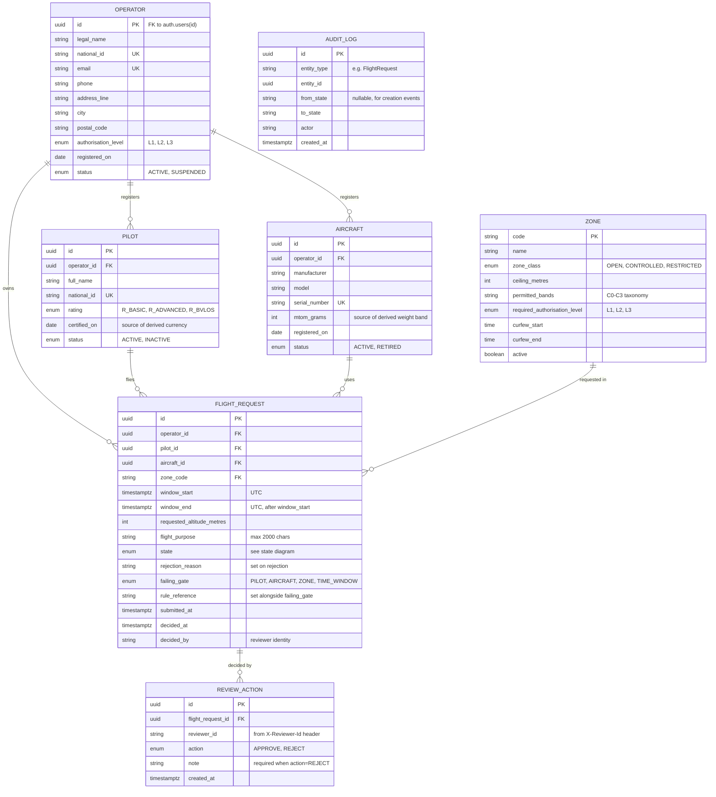
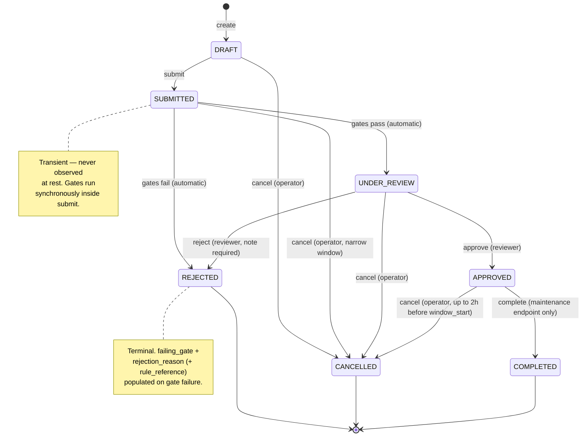
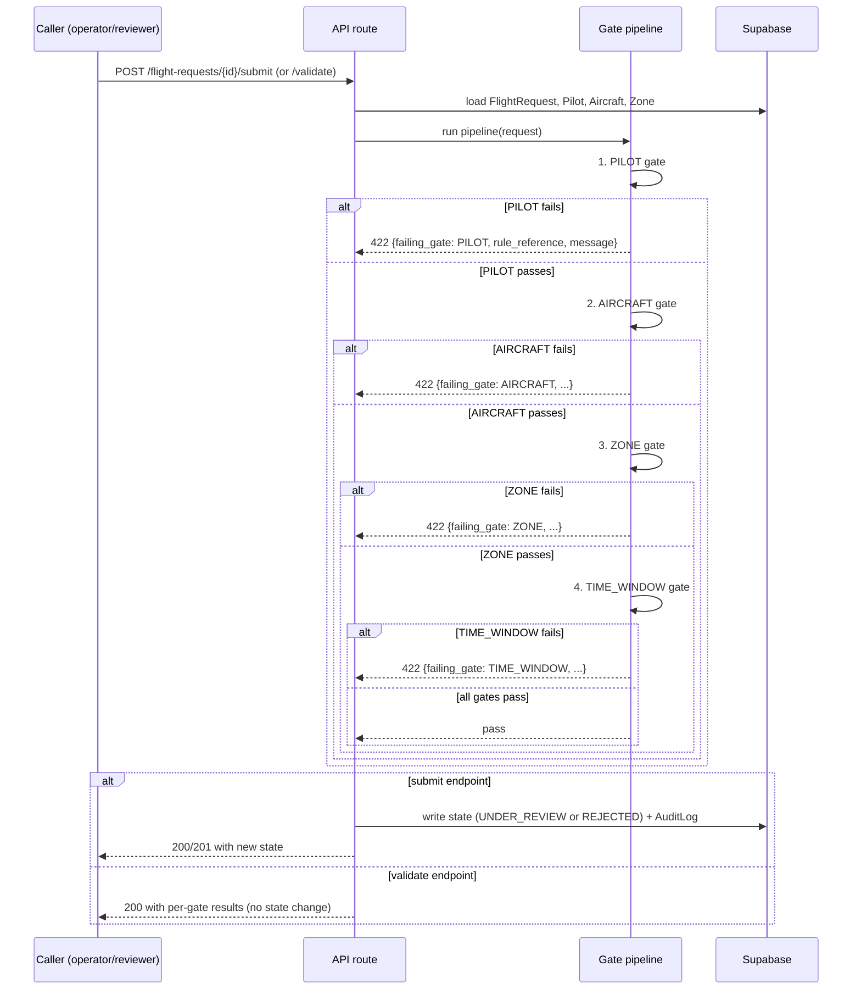

# UML Diagrams

Generated reference, derived from `01-data-model.md` and
`02-state-machine.md`. If those docs and the schema ever drift, treat them
as the source of truth and regenerate this file — don't hand-edit this one
out of sync with them.

Mermaid syntax — renders natively on GitHub, GitLab, and most markdown
viewers.

## Entity-Relationship Diagram

`AuditLog` has no FK drawn — it's a generic append-only log keyed by
`(entity_type, entity_id)` against any entity, not a typed relation. `Zone`
is read-only reference data, not written by ordinary product flows.

## Flight Request State Diagram

Any `(from, action)` pair not drawn above is illegal and the API returns
`409` — including transitions that look plausible, like re-submitting a
request already `UNDER_REVIEW`.

## Gate Pipeline (sequence, shared by `submit` and `validate`)

